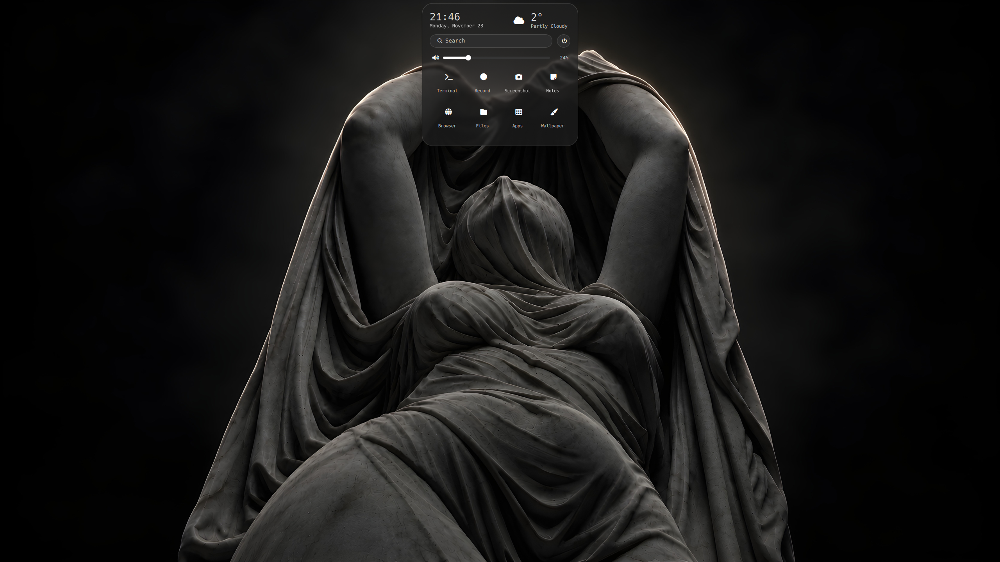

# Saltyfunnels Pill

A minimal Arch Linux + Hyprland desktop built around a single Quickshell "Pill".
All colours are generated from your wallpaper with matugen.



## The island

A small clock pill at the top of the screen. Click it (or drag it down) and it
expands into a menu:

- **Header:** clock, date (click for the calendar) and weather
- **Search and launcher:** most used apps first, right-click or Delete to hide an app
- **Media controls** and a volume slider
- **Pinned buttons:** terminal, record, screenshot, desktops, clipboard, notes,
  emojis, wallpapers, browser, files
- **Updates:** shows pending pacman updates and runs the update in a terminal
- **Power:** log out, reboot, shut down

Swipe the pill left or right for the status and apps panels.

Also included: SDDM login screen and hyprlock lock screen themed with matugen,
Colloid icons, and themed Thunar, GTK and kitty.

## Install

On a fresh Arch install, from your normal user account:

```
git clone https://github.com/Saltyfunnel/pill
cd pill
chmod +x *.sh
sudo ./install.sh
```

The installer configures pacman, installs GPU drivers and packages, installs
Quickshell, matugen and LocalSend, copies the configs, downloads wallpapers,
sets fish as your shell, installs the icon theme and enables SDDM.
Logs are written to `/tmp/saltyfunnels-shell-install-logs`.

Reboot afterwards and pick the Hyprland session.

## Keybinds

| Key | Action |
| --- | --- |
| Super + D | App launcher |
| Super + V | Clipboard history |
| Super + W | Wallpaper picker |

## Customising

- **Weather town:** set `town` on the `WeatherChip` in `configs/quickshell/Island/IslandMenu.qml`
  (empty means it guesses from your IP).
- **Pinned buttons and button columns:** `configs/quickshell/Common/QuickItems.qml`.
- **Sizes, spacing and fonts:** `configs/quickshell/Common/Theme.qml`.
- **Launcher state** (most used, hidden apps): `~/.local/state/island/apps.json`.

## Layout

```
install.sh     installer
configs/       dotfiles copied to ~/.config (hypr, quickshell, matugen, kitty, fish, ...)
scripts/       helper scripts copied to ~/.config/scripts
```
